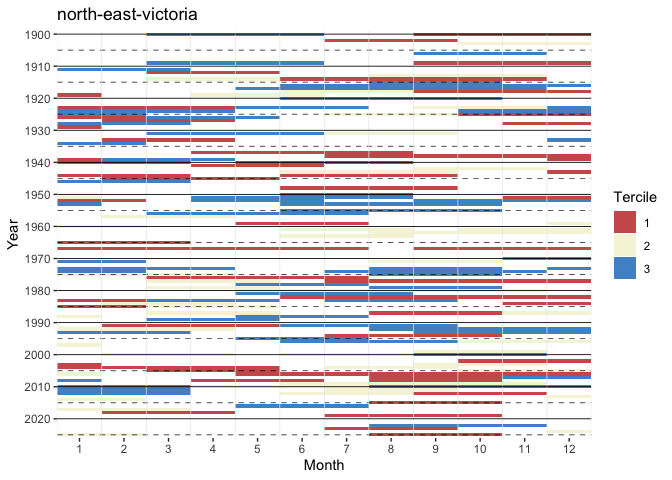
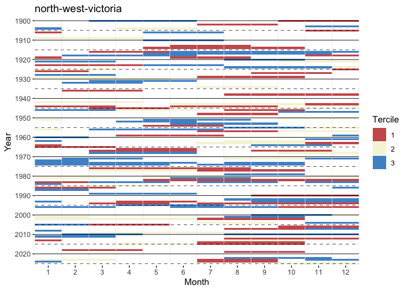
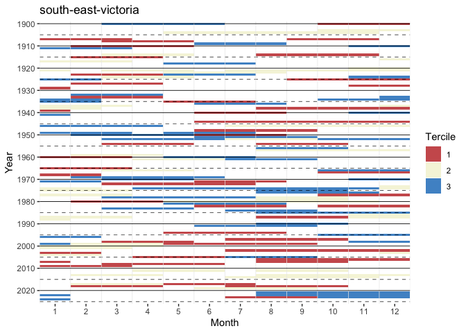
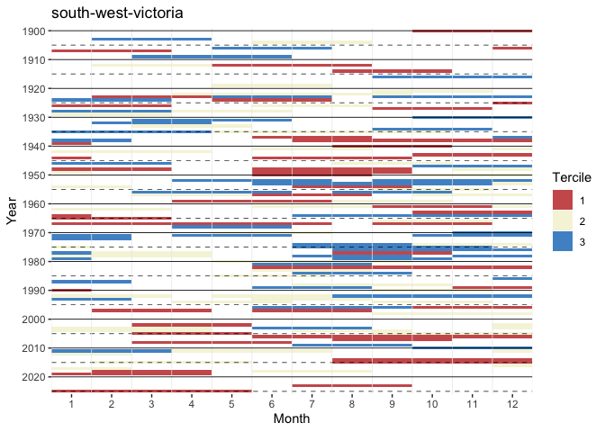
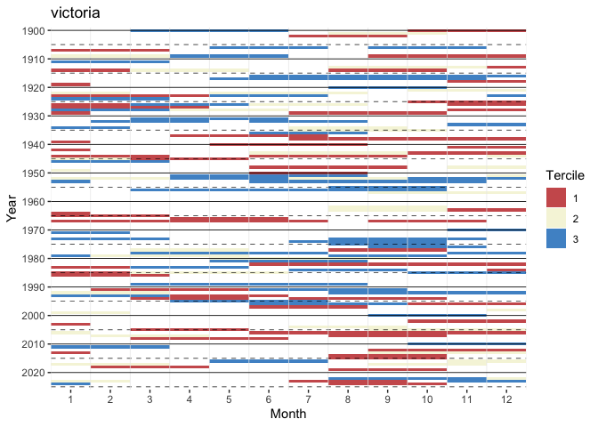

# VicWaCI: Identifying wet and dry spells in Victoria (AGCD)


Reading in monthly AGCD precip files Victorian subregions and Victoria as a whole

``` r
#Create list of files
files <- list.files(path = "/Users/toz008/Documents/VICWaCI/VicWaCI_inputData", pattern = "monthly", full.names = TRUE)

#Extracting region names from filenames
regions <- str_remove(basename(files), "agcd_v2-0-4_precip_total_")
regions <- str_remove(basename(regions), "_monthly_1900-2025.nc")

#Read in precip data and assign each element in the list as the filename
Monthly_AGCD_precip <- set_names(files, basename(files)) |> 
  map(\(x) ncvar_get(nc_open(x), "precip"))

Monthly_AGCD_precip <- set_names(Monthly_AGCD_precip, regions)
```

Calculating monthly terciles

``` r
#Create time vector
time <- ymd(as.Date("1900-01-16"))+ dhours(ncvar_get(nc_open(files[[1]]),'time'))

#Create list of dataframes
Precip_monthly_df <- map(Monthly_AGCD_precip, \(x) data.frame(Date = time, Year = year(time), Month = month(time), Precip = x))

#exclude month grouping if you want to calculate terciles with all months thrown into one bucket
Precip_monthly_df <- map(Precip_monthly_df, 
                         \(x) x %>% 
   group_by(Month) %>% 
   mutate(Low_cutoff = quantile(Precip, 1/3, na.rm = TRUE), High_cutoff = quantile(Precip, 2/3, na.rm = TRUE)) %>% 
   mutate(Tercile = if_else(Precip >= High_cutoff, 3, if_else(Precip <= Low_cutoff, 1, 2))) %>% 
   mutate(Mean = mean(Precip)))
```

Check of tercile counts (same number of months in each tercile?)

``` r
map(Precip_monthly_df, 
    \(x) x %>% 
  group_by(Tercile) %>% 
  summarise(Terc_count = n()))
```

```
## $`north-east-victoria`
## # A tibble: 3 × 2
##   Tercile Terc_count
##     <dbl>      <int>
## 1       1        505
## 2       2        502
## 3       3        505
## 
## $`north-west-victoria`
## # A tibble: 3 × 2
##   Tercile Terc_count
##     <dbl>      <int>
## 1       1        504
## 2       2        502
## 3       3        506
## 
## $`south-east-victoria`
## # A tibble: 3 × 2
##   Tercile Terc_count
##     <dbl>      <int>
## 1       1        504
## 2       2        504
## 3       3        504
## 
## $`south-west-victoria`
## # A tibble: 3 × 2
##   Tercile Terc_count
##     <dbl>      <int>
## 1       1        504
## 2       2        504
## 3       3        504
## 
## $victoria
## # A tibble: 3 × 2
##   Tercile Terc_count
##     <dbl>      <int>
## 1       1        504
## 2       2        504
## 3       3        504
```

Tercile plots showing events of length 3 months and greater

``` r
tercile_plot_list <- imap(Precip_monthly_df, function(df, name) {
  ggplot(df %>% group_by(grouping = rleid(Tercile)) %>% filter(n() >= 3), aes(x = Month, y = Year, fill = factor(Tercile)))+
  geom_tile()+
  scale_y_reverse(expand=c(0,0),breaks = seq(from=1900, to=2025, by=10))+
  coord_cartesian(ylim = c(1899, 2026))+
  scale_fill_manual(values = c("1"="indianred", "2"= "beige", "3"="steelblue3"))+
  scale_x_continuous(expand=c(0,0), breaks = seq(1,12,1))+
#  scale_y_continuous(expand=c(0,0), breaks = seq(from=1900, to=2025, by=10))+
  labs(x="Month",y="Year",fill = "Tercile",title = name)+
  theme_bw()+
#  theme(panel.grid = element_blank())
  theme(panel.grid.major.y = element_line(colour = "black", linewidth = 0.3),panel.grid.minor.y = element_line(linetype = "dashed", colour = "black"), panel.grid.major.x = element_blank(), panel.background = element_rect(fill = NA), panel.ontop = TRUE, panel.border = element_blank())
})

walk(tercile_plot_list, print)
```

<!-- --><!-- --><!-- --><!-- --><!-- -->

``` r
#save plots of monthly spells
walk2(names(tercile_plot_list), tercile_plot_list, function(name, plot) {
  ggsave(filename = paste0("/Users/toz008/Documents/VICWaCI/Plots/",name, "_monthlySpells_AGCD.png"), plot = plot, width = 8, height = 8)
         })
```


``` r
#saving timeseries of terciles to .csv

iwalk(Precip_monthly_df, ~ write_csv(.x, paste0(.y, ".csv")))
```

